# Shudipto Trafder

I build backend systems for AI agents, mostly in Python, and I build them in the open.

I started in mobile with Android and Flutter, moved into machine learning, and now spend most of my time on distributed systems, scalable architecture and the infrastructure that AI agents run on. These days that means building 10xGraph. On the side I enjoy training and fine-tuning small models, and seeing how far a small one can go on a narrow job.

## 10xGraph

My main project. Open-source, self-hosted infrastructure for AI applications. You write the agents, tools and tasks. 10xGraph runs them behind an API server with authentication, roles, tenant isolation, durable state in Postgres and Redis, background jobs and tracing, and it generates the Docker and Kubernetes files to deploy them. MIT licensed and running in production.

| Repository | What it is |
| :--- | :--- |
| [10xGraph](https://github.com/10xGraph/10xGraph) | Core library, Python |
| [10xgraph-api](https://github.com/10xGraph/10xgraph-api) | API server and CLI |
| [10xgraph-client](https://github.com/10xGraph/10xgraph-client) | TypeScript client |

[Documentation](https://10xgraph.com/docs) · [Engineering blog](https://10xgraph.com/blog)

## Libraries

- [InjectQ](https://github.com/10xHub/injectq): dependency injection for Python
- [snowflakekit](https://github.com/10xHub/snowflakekit): distributed ID generation
- [textxtract](https://github.com/10xHub/textxtract): text extraction

## Side projects

- [chess](https://github.com/Iamsdt/chess): chess coaching with Stockfish and an LLM. A new version with a custom model is in progress.

## What I work on

- Guarantees for AI agents: tenant isolation, crash-safe tool execution, approval steps a model cannot bypass
- Multi-tenant APIs and distributed systems in Python
- Testing and evaluating agent behaviour in CI
- Fine-tuning small language models for specific tasks

## Writing and research

- Engineering notes on the [10xGraph blog](https://10xgraph.com/blog) and on [Medium](https://medium.com/@iamsdt)
- Peer-reviewed paper on transformer-based hate-speech classification in Bengali, IEEE PEEIACON 2024 ([Google Scholar](https://scholar.google.com/citations?user=NodW2XMAAAAJ))
- [Kaggle](https://www.kaggle.com/iamsdt) Notebooks Expert

## Contact

[LinkedIn](https://www.linkedin.com/in/iamsdt) · [X](https://x.com/iamsdt) · [Medium](https://medium.com/@iamsdt)

---

### A year in code
---

  <picture>
    <source media="(prefers-color-scheme: dark)" srcset="profile/stats-dark.svg"/>
    
  </picture>
  <picture>
    <source media="(prefers-color-scheme: dark)" srcset="profile/top-langs-dark.svg"/>
    
  </picture>

Work hard in silence, let success make the noise.
